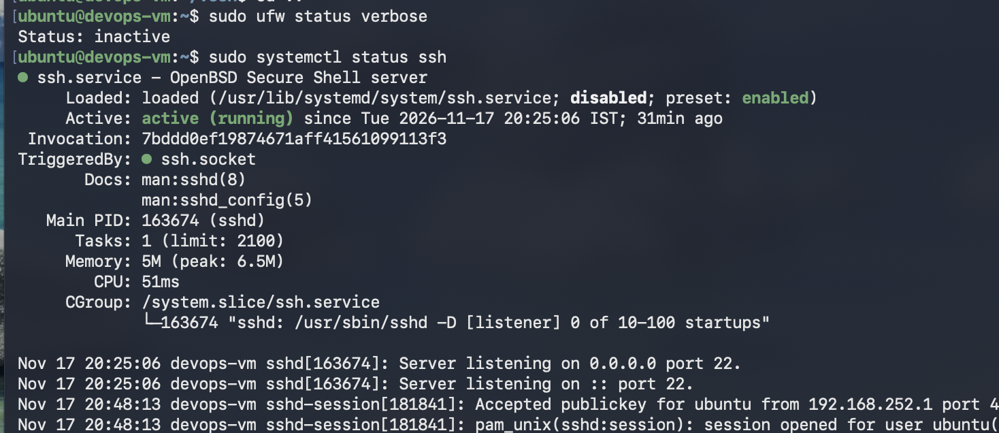
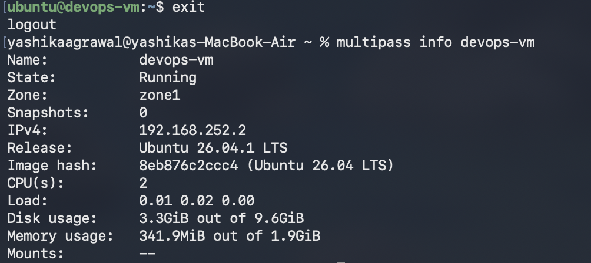
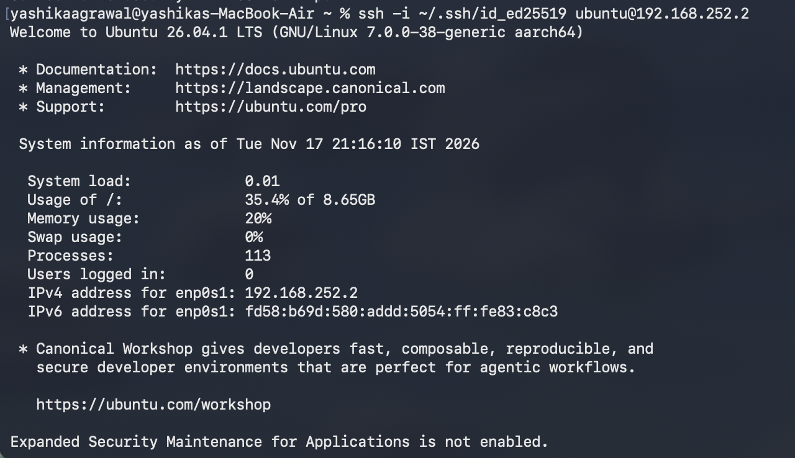
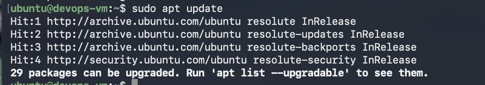
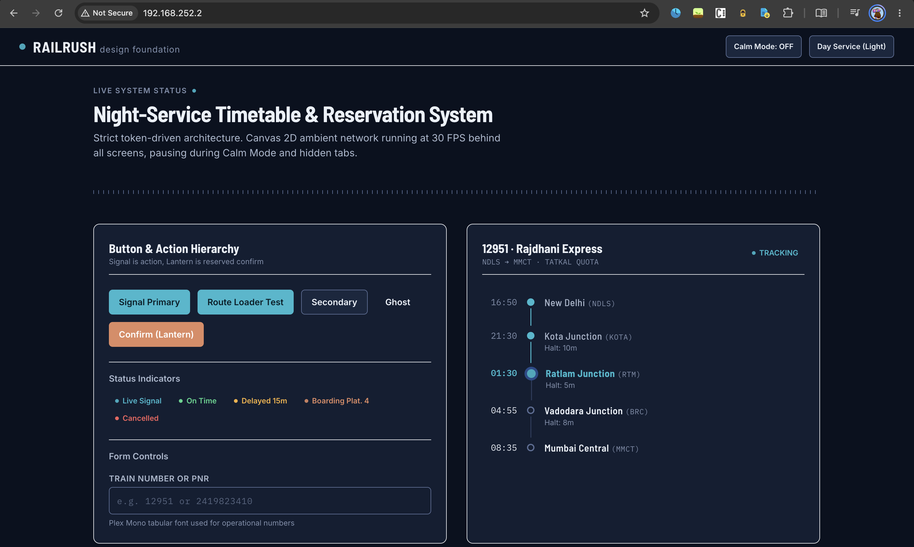

# Deploying with MultiPass

multipass will be used to make ci cd pipelines, make VM , deploy in linux locally.

`multipass list` This command will help to list down all the VMs, initially it will sh no instances.

`multipass launch --name devops-vm --cpus 2 --memory 2G --disk 10G ` - This command will create a virtual instance by default ubuntu machine, here name is devops-vm with 2 cpu, memory 2gb, disk 10gb.

`multipass shell devops-vm` - This goes inside our instance created

Add SSH public key generated from github reference docs from macOS to ubuntu machine inside authorized_keys folder.

If you use external cloud like excloud then the ssh won't work why? because you have not added security groups ( firewall) here. SSH works on port 22. our instance machine does not allow anything on port 22.

But if you use local ubuntu machine it might not have those firewall rules, so we could connect to it.



- The above screenshot shows it listens on port 22, and is active running to listen on it.



`ssh -i ~/.ssh/id_ed25519 ubuntu@YOUR_VM_IP`- Run this command to check if you are able to connect to your machine.

It will say:

The authenticity of host '192.168.252.2 (192.168.252.2)' can't be established.

ED25519 key fingerprint is: SHA256:*********

This key is not known by any other names.

Are you sure you want to continue connecting (yes/no/[fingerprint])? i got this when i try to connect whats this

This means:

**"I've reached a server at this IP, but I've never connected to it before. How do I know this is really the server you intended to reach?"**

When you say yes, or type fingerprint, it will permanently add this IP. Also the fingerptint is ubuntu's public key which is separate from the key pair you generated from mac.

You can get a message like below:

```
Warning: Permanently added '192.168.252.2' (ED25519) to the list of known hosts.
Connection closed by 192.168.252.2 port 22
```

The first line means:

* Your Mac received the Ubuntu server's host key.
* You accepted it.
* SSH saved it in `~/.ssh/known_hosts`

The second line means:

* Your Mac connected to port 22.
* The remote SSH server closed the connection unexpectedly.

you can try again, or check in verbose mode the issue.



Here we connected to our machine from our mac, using our private key from our mac.

## Deploying our project to ubuntu

Now to deploy you app to your ubuntu machine, we need to first push our project to github. lets say: https://github.com/Yashika-Agrawal/RailRush this is the github url of project.

run the below command on ubuntu vm:

```
sudo apt update
```



### Connecting Ubuntu VM to a Private GitHub Repository

### Why do we need this?

Our RailRush repository is private. We need to give our Ubuntu VM permission to clone the repository without making it public or entering GitHub credentials every time.

We use an SSH Deploy Key for this.

#### Step 1: Generate an SSH key on Ubuntu

Inside the Ubuntu VM:

```
ssh-keygen -t ed25519 -C "railrush-devops-vm" -f ~/.ssh/railrush_github
```

This creates two files:

* `~/.ssh/railrush_github` – Private key. Never share this.
* `~/.ssh/railrush_github.pub` – Public key. This is shared with GitHub.

We left the passphrase empty for this learning exercise.

#### Step 2: Add the public key to GitHub

1. Open the RailRush GitHub repository.
2. Navigate to Settings → Deploy keys.
3. Click Add deploy key.
4. Give it a title: `Ubuntu Multipass VM`.
5. Copy the contents of `~/.ssh/railrush_github.pub`.
6. Keep Allow write access unchecked.

A Deploy Key grants a particular machine access to a particular repository.

We only need read access because our VM needs to clone and pull code, not push changes.

#### Step 3: Test the SSH connection

```
ssh -T -i ~/.ssh/railrush_github -o IdentitiesOnly=yes git@github.com
```

Initially, GitHub returned:

```
Permission denied (publickey).
```

Why? SSH wasn't automatically selecting our custom-named private key.

We explicitly specified the key using `-i` and `IdentitiesOnly=yes`.

#### Step 4: Configure SSH so we don't need to specify the key every time

Create or edit:

```
nano ~/.ssh/config
```

Add:

```
Host github-railrush
    HostName github.com
    User git
    IdentityFile ~/.ssh/railrush_github
    IdentitiesOnly yes
```

Set permissions:

```
chmod 700 ~/.ssh
chmod 600 ~/.ssh/config
chmod 600 ~/.ssh/railrush_github
```

Now `github-railrush` is an SSH alias that tells SSH which key to use.

#### Step 5: Clone the private repository

```
git clone git@github-railrush:Yashika-Agrawal/RailRush.git
```

Our repository is now available at:

```
/home/ubuntu/RailRush
```

Check:

```
cd ~/RailRush
pwd
ls -la
```

Our repository contains a frontend directory:

```
RailRush/
└── frontend/
    ├── src/
    ├── public/
    ├── package.json
    ├── package-lock.json
    ├── vite.config.ts
    └── index.html
```

We are deploying only the React + Vite frontend for now. The backend is not part of this exercise.

We inspected `package.json` and found:

```
{
  "scripts": {
    "dev": "vite",
    "build": "tsc -b && vite build",
    "preview": "vite preview"
  }
}
```

The build script first runs the TypeScript compiler and then Vite's production build.

#### 3. Installing Node.js using NVM

NVM stands for Node Version Manager.

It allows us to install and manage Node.js versions without depending on Ubuntu's system-managed Node installation.

Install curl:

```
sudo apt install -y curl
```

Install NVM:

```
curl -o- https://raw.githubusercontent.com/nvm-sh/nvm/v0.41.0/install.sh | bash
```

Reload the shell configuration:

```
source ~/.bashrc
```

Verify NVM:

```
command -v nvm
```

##### Install Node.js 22

```
nvm install 22
nvm alias default 22
```

Verify:

```
node -v
npm -v
```

Our installed Node.js version was:

```
v22.23.5
```

Where is Node installed?

NVM installs Node under:

```
/home/ubuntu/.nvm/
```

This is a user-level installation. Node remains available when we change directories.

Important directory distinction:


| Item                  | Location                           |
| --------------------- | ---------------------------------- |
| NVM                   | `~/.nvm`                           |
| SSH keys              | `~/.ssh`                           |
| RailRush source code  | `~/RailRush`                       |
| Frontend dependencies | `~/RailRush/frontend/node_modules` |
| Production build      | `~/RailRush/frontend/dist`         |

 Installing Frontend Dependencies

Move into the frontend directory:

```
cd ~/RailRush/frontend
```

Install dependencies:

```
npm ci
```

### Why npm ci instead of npm install?

* `npm ci` installs dependencies using the exact versions recorded in `package-lock.json`.
* It is suitable for repeatable builds and deployment environments.
* It does not intentionally update the lockfile.
* It recreates the `node_modules` directory.

Our project already has a `package-lock.json`, so `npm ci` is appropriate.

5. Creating the Production Build

Run:

```
npm run build
```

This executes:

```
tsc -b && vite build
```

### What happens?

1. `tsc -b` runs the TypeScript build.
2. `vite build` bundles and optimizes the frontend.
3. The generated production files are placed inside `dist/`.

Our build succeeded:

```
vite v6.4.6 building for production...

✓ 40 modules transformed.

dist/index.html
dist/assets/index-....css
dist/assets/index-....js

✓ built in 784ms
```

### Important directories


| Directory       | Purpose                        |
| --------------- | ------------------------------ |
| `src/`          | Application source code        |
| `node_modules/` | Installed project dependencies |
| `dist/`         | Optimized production files     |

Nginx needs the production build, not the entire source code or `node_modules`.


**6. Installing Nginx**

#### What is Nginx?

Nginx is a web server.

Our production frontend currently exists as static files inside `dist/`. Nginx receives browser requests and serves those files over HTTP.

Install:

```
sudo apt update
sudo apt install -y nginx
```

Check its status:

```
sudo systemctl status nginx
```

If needed:

```
sudo systemctl enable --now nginx
```

Meaning:

* `start`: Start the service now.
* `enable`: Start it automatically during system boot.
* `--now`: Enable and start together.

### Test the default Nginx page

From Ubuntu:

```
curl http://localhost
```

We received the default Nginx welcome page.

Then we opened the VM's private IP from the Mac browser:

```
http://192.168.252.2
```

We successfully accessed the Nginx welcome page.

This confirmed that our Mac could communicate with the Ubuntu VM over HTTP.

## 7. Deploying RailRush using Nginx

### Step 1: Understand the directories

Our production build:

```
/home/ubuntu/RailRush/frontend/dist/
```

Nginx's conventional website directory:

```
/var/www/
```

We created a directory for RailRush:

```
sudo mkdir -p /var/www/railrush
```

Copy the production build:

```
sudo cp -r ~/RailRush/frontend/dist/. /var/www/railrush/
```

### Step 2: Set permissions

Nginx runs under the `www-data` user on Ubuntu.

We set ownership and permissions:

```
sudo chown -R root:www-data /var/www/railrush
sudo chmod -R 755 /var/www/railrush
```

This allows Nginx to read the deployed files.

### Step 3: Create an Nginx site configuration

```
sudo nano /etc/nginx/sites-available/railrush
```

Configuration:

```
server {
    listen 80;
    listen [::]:80;

    server_name _;

    root /var/www/railrush;
    index index.html;

    location / {
        try_files $uri $uri/ /index.html;
    }
}
```

Understanding the configuration:

* `listen 80`: Listen for HTTP traffic on port 80.
* `server_name _`: Default catch-all server name.
* `root`: Directory containing our deployed website.
* `index`: Default page served when a directory is requested.
* `try_files`: Try the requested file and fall back to `index.html`.

The fallback is important for React client-side routing. For example, a route like `/trains` should return the React application's `index.html` so the frontend router can handle it.

### Step 4: Enable the RailRush site

Nginx stores available configurations in:

```
/etc/nginx/sites-available/
```

Enabled configurations are linked inside:

```
/etc/nginx/sites-enabled/
```

Create the symbolic link:

```
sudo ln -s /etc/nginx/sites-available/railrush /etc/nginx/sites-enabled/
```

Disable the default Nginx website:

```
sudo rm /etc/nginx/sites-enabled/default
```

We are disabling the default website configuration, not uninstalling Nginx.

### Step 5: Validate and reload Nginx

Always test the configuration before reloading:

```
sudo nginx -t
```

Expected:

```
syntax is ok
test is successful
```

Reload:

```
sudo systemctl reload nginx
```

### Step 6: Verify deployment

Open from the Mac browser:

```
http://192.168.252.2
```

RailRush now appears instead of the default Nginx welcome page.

**Our first manual frontend deployment is successful!**

## 8. Current Deployment Architecture

```
                Mac Browser
                     |
                     | HTTP - Port 80
                     |
              Ubuntu Multipass VM
                     |
                   Nginx
                     |
              /var/www/railrush/
                     |
                  index.html
                     |
                   assets/
                CSS and JS
```


Deployed our website to ubuntu server: 😄


