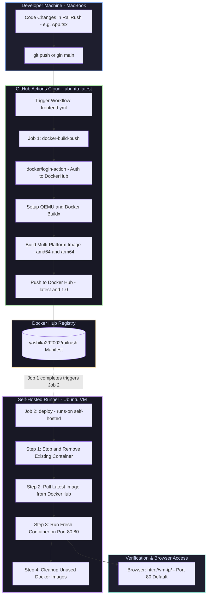

# Automated CI/CD & Docker Deployment Flow

This document provides a fast visual overview of the entire end-to-end deployment pipeline.

---

## Architecture & Workflow Diagram

---

## Quick Reference Summary

| Phase | Where It Runs | Key Actions | Output |
| :--- | :--- | :--- | :--- |
| **1. Trigger** | Developer Mac | `git push origin main` | Pushes commit to GitHub |
| **2. Build & Publish** | GitHub Cloud (`ubuntu-latest`) | Logs into Docker Hub, uses QEMU + Buildx to build multi-arch images | Pushes `yashika292002/railrush:latest` and `:1.0` |
| **3. Deploy** | Ubuntu Multipass VM (`self-hosted`) | Stops old container, pulls latest image, runs on default port `80:80`, cleans unused layers | Zero-touch automated deployment |
| **4. Live Access** | Any Browser | Open `http://<vm-ip>/` (Standard Port 80) | Real-time deployed application |
