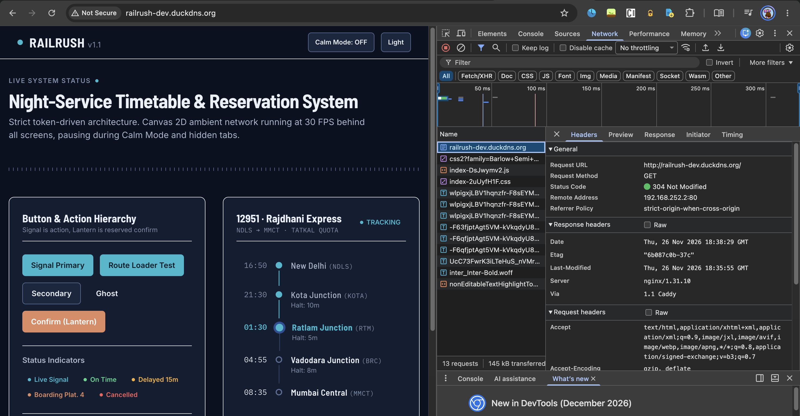

# DuckDNS, Caddy Reverse Proxy & Automated SSL (HTTPS)

## 1. Why Are We Doing This? (The Goal)

Until now, our application deployment has two major limitations:

1. **Unencrypted HTTP:** We access the app using `http://<ip>/`. Traffic is plain text (no padlock in browser, no HTTPS security).
2. **IP & Port Exposure:** Users must type raw IP addresses like `http://192.168.252.2/`. If we have multiple apps or services, users would have to remember strange ports like `:3000`, `:5000`, or `:8080`.

### What We Are Building:

- **A Free Public Domain Name:** Using **DuckDNS** (e.g., `yoursubdomain.duckdns.org`) instead of raw IP addresses.
- **A Reverse Proxy:** Using **Caddy** as the single "front door" on the server.
- **Automated SSL/TLS Certificates:** Caddy automatically gets a free, genuine SSL certificate from **Let's Encrypt** and auto-renews it.
- **Load Balancing & Microservices:** Caddy receives traffic on standard port `443` (HTTPS) and securely routes it to our backend Docker containers running in the background.

---

## 2. Architecture: How Traffic Flows

```text
User's Browser (https://yourname.duckdns.org)
                     │
                     ▼ (Standard Port 443 - Encrypted HTTPS)
          ┌──────────────────────┐
          │ Caddy Reverse Proxy  │ ◄── Handles Automatic SSL (Let's Encrypt)
          └──────────┬───────────┘
                     │ (Internal Routing)
                     ▼
          ┌──────────────────────┐
          │   Docker Container   │ (e.g. railrush-container on internal port)
          └──────────────────────┘
```

---

## 3. What is DuckDNS & Why Use It?

- **What it is:** DuckDNS is a completely free Dynamic DNS (DDNS) service that provides subdomains under `.duckdns.org`.
- **Why we need it:**
  - Let's Encrypt (the Certificate Authority that gives free SSL certificates) **cannot issue certificates to private local IPs** like `192.168.252.2`.
  - It **requires a real domain name** (like `xxxx.duckdns.org`) to verify ownership and issue a trusted SSL certificate.

---

## 4. What is Caddy & Why Choose It Over Nginx?

- **What it is:** Caddy is an open-source, modern web server and reverse proxy written in Go.
- **Why Caddy over Nginx for SSL:**
  - With Nginx, enabling HTTPS requires installing `certbot`, editing complex config files, setting up cron jobs for renewals, and configuring port redirects.
  - With Caddy, **automatic HTTPS is on by default**. You write a 3-line `Caddyfile`, and Caddy automatically fetches the SSL certificate, configures HTTPS, redirects all HTTP traffic to HTTPS, and renews the certificate before it expires.

### Simple `Caddyfile` Example:

```caddyfile
yourname.duckdns.org {
    reverse_proxy localhost:8080
}
```

---

## 5. Verification: Proof That Caddy is Reverse Proxying the Traffic

When visiting `http://railrush-dev.duckdns.org`, we can inspect the browser **Developer Tools (Network Tab)** to verify that requests are indeed passing through Caddy before reaching our Nginx frontend container:

### Evidence from Network Response Headers:

- **`Server: nginx/1.31.10`**: The origin server running inside our `frontend` Docker container that serves the React build.
- **`Via: 1.1 Caddy`**: Proof that **Caddy intercepted the client request, acted as the reverse proxy gateway, and forwarded it to the frontend container!**




---

## 6. What are the Next Implementation Steps?

1. **DuckDNS Configuration (Done):** Mapped `railrush-dev.duckdns.org` to our VM IP (`192.168.252.2`).
2. **Caddy Reverse Proxy (Done):** Caddy listens on port 80 and forwards requests to `frontend:80` across the internal Docker network.
3. **Next Step - Automated SSL/HTTPS:** Enable TLS encryption so the browser shows a secure padlock 🔒 instead of "Not Secure".
