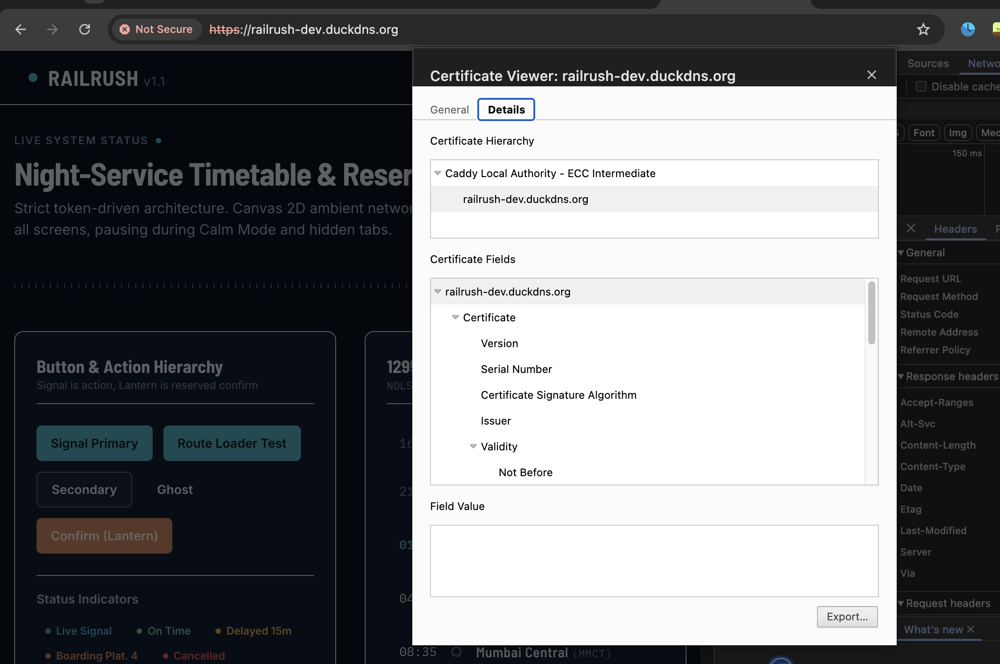
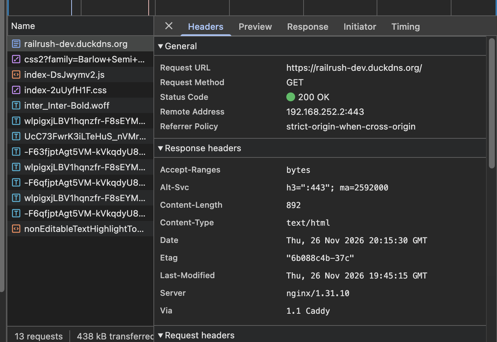

# HTTPS Verification & Reverse Proxy Headers (X-Forwarded-*, Host)

> **Core Networking Reference:** For an in-depth breakdown of what SSL/TLS is, encryption, authentication, and the difference between SSL and TLS, see [ssl-vs-tls.md](../../networking/ssl-vs-tls.md).

---

## 1. Evidence of HTTPS: Where to Verify in the Browser

When visiting `https://railrush-dev.duckdns.org`, you can find concrete evidence in two places:

### A. The Address Bar Padlock / Certificate Viewer

1. Click the icon to the left of the URL in the address bar (the padlock or tune icon).
2. Click **"Connection is not secure"** (or "Certificate") ➔ **"Certificate details"**.
3. You will see the cryptographic certificate generated by Caddy:
   - **Certificate Hierarchy:** `Caddy Local Authority - ECC Intermediate` ➔ `railrush-dev.duckdns.org`.
   - **Issuer (CA):** Proves Caddy's built-in PKI automatically issued the certificate for our DuckDNS domain via `tls internal`!



### B. The Browser DevTools (Network Tab)

1. Open DevTools (`Cmd + Option + I`) ➔ **Network** tab ➔ reload the page.
2. Click on the document request (`railrush-dev.duckdns.org`).
3. Check the **General & Response Headers**:
   - **Request URL:** `https://railrush-dev.duckdns.org/` (Protocol is explicitly `https`).
   - **Remote Address:** `192.168.252.2:443` (Listening directly on the standard secure HTTPS port `443`!).
   - **Status Code:** `200 OK`.
   - **`Alt-Svc: h3=":443"`**: Proves modern HTTP/3 over TLS is enabled on port 443!
   - **`Via: 1.1 Caddy`**: Proof that Caddy is acting as the reverse proxy gateway.
   - **`Server: nginx/1.31.10`**: The backend React frontend container serving the content.



---

## 2. What are `header_up Host`, `X-Forwarded-For`, `X-Real-IP`?

When Caddy sits in front of your backend containers as a reverse proxy, an architectural problem happens:

### The Problem: The Backend Becomes "Blind"

```text
Real Client (IP: 49.37.12.5) 
         │
         ▼
[ Caddy Reverse Proxy ] (IP: 172.20.0.3 inside Docker)
         │
         ▼
[ Backend / API Container ]
```

When your backend container looks at incoming requests:

- It sees the caller's IP as `172.20.0.3` (Caddy's internal Docker IP), **NOT** `49.37.12.5` (the real user!).
- It sees the destination host as `frontend:80`, **NOT** `railrush-dev.duckdns.org`!

If your backend needs to rate-limit users, log real client locations, or redirect links, it gets confused.

---

## 3. The Solution: Proxy Headers

We pass headers from Caddy "up" to the upstream backend container:


| Header                  | What it tells the Backend Container                                         |
| :---------------------- | :-------------------------------------------------------------------------- |
| **`X-Forwarded-For`**   | The**real client IP address** of the user sitting at their computer.        |
| **`X-Forwarded-Proto`** | Whether the original user connected via`https` or `http`.                   |
| **`X-Real-IP`**         | The direct IP address of the immediate connecting client.                   |
| **`Host`**              | The original domain name typed in the browser (`railrush-dev.duckdns.org`). |

---

## 4. Why You Didn't Need to Write Them in Caddy! (Caddy's Superpower)

In **Nginx**, you must manually configure these headers for every single route:

```nginx
# In Nginx, you have to write all this manually:
proxy_set_header Host $host;
proxy_set_header X-Real-IP $remote_addr;
proxy_set_header X-Forwarded-For $proxy_add_x_forwarded_for;
proxy_set_header X-Forwarded-Proto $scheme;
```

In **Caddy**, **ALL of these headers are passed automatically by default!**
When you write:

```caddyfile
reverse_proxy frontend:80
```

Caddy automatically sets:

- `X-Forwarded-For` = Client's real remote IP
- `X-Forwarded-Proto` = `https`
- `X-Forwarded-Host` = `railrush-dev.duckdns.org`

### Why teachers/tutorials sometimes write `header_up`:

If a specific backend framework (like certain Django, Spring, or Node setups) strictly requires the `Host` header to match the external domain instead of the upstream container name, you can explicitly override it using `header_up`:

```caddyfile
railrush-dev.duckdns.org {
    tls internal
    reverse_proxy frontend:80 {
        header_up Host {host}
        header_up X-Real-IP {remote_host}
    }
}
```

- `header_up` means: *"Modify or send this HTTP header **upwards** to the backend container."*
- `header_down` means: *"Modify this HTTP header **downwards** in the response back to the user's browser."*
