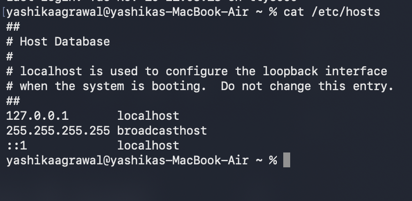
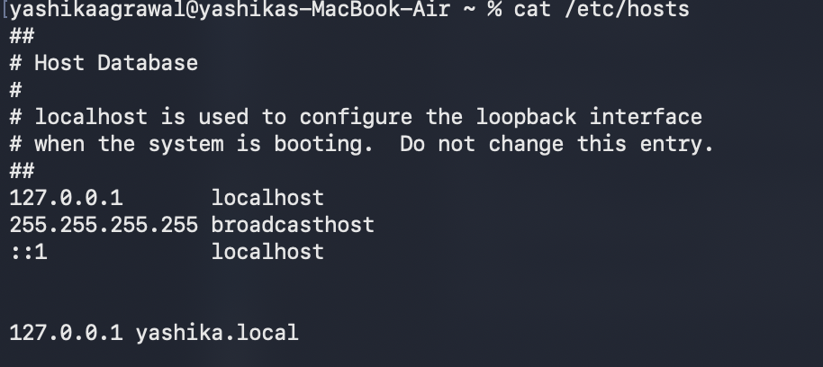
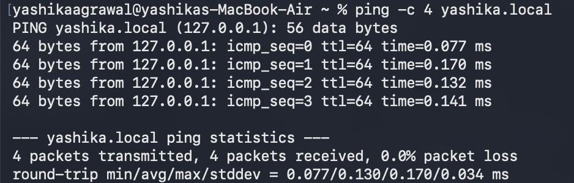

# Intro to DevOps

curl https://localhost:3000

127.0.0.1 is a ip address of my machine, but we don't write this while starting app using our ip address.

Our machine have there own DNS, here in above screenshot localhost is redirected to 127.0.0.1

Tried adding my own local dns route: yashika.local

Confirming if pinging to yashika.local will route to our local:

- ping : checks whether a machine is reachable over a network
- -c 4: sends 4 packets

In response mac resolved yashika.local to 127.0.01 using my hosts file entry, 4 packets transmitted and 4 packets received.

Loopback networking: 127.0.0.1 points back to my own machine.

`/etc/hosts` lets you manually map hostnames without configuring a DNS server.

Now our application is running on let's say port : 3000 which is connected to internet, we can have a public ip address , map it to yashika.local and others can use it if we keep our laptop 24/7 open.

Problems with this:

- You can't keep your laptops on 24/7
- The hardware of our laptop is not optimzied to be a server to handle traffic.
- Public ip's are limited, ipv4 have already been exhausted.

So our Internet Service provider keep us behind nat( network address translation), they route our request to let's suppose youtube.com and can provide us with public IP. Jio keeps us behind cgnat which has one public IP for a particular area, so they can't provide public IP, other local service providers which are not behind cgnat can provide us with public IP.
