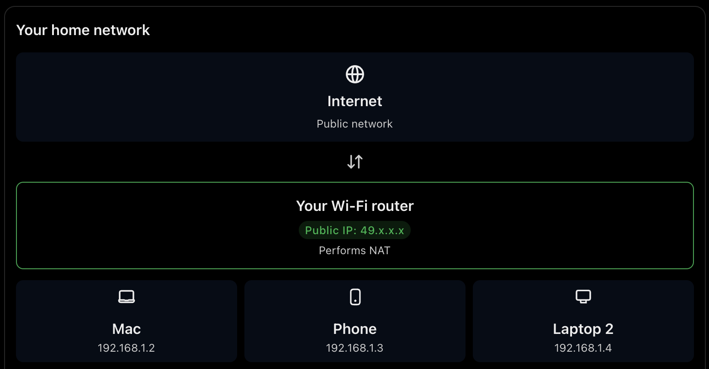
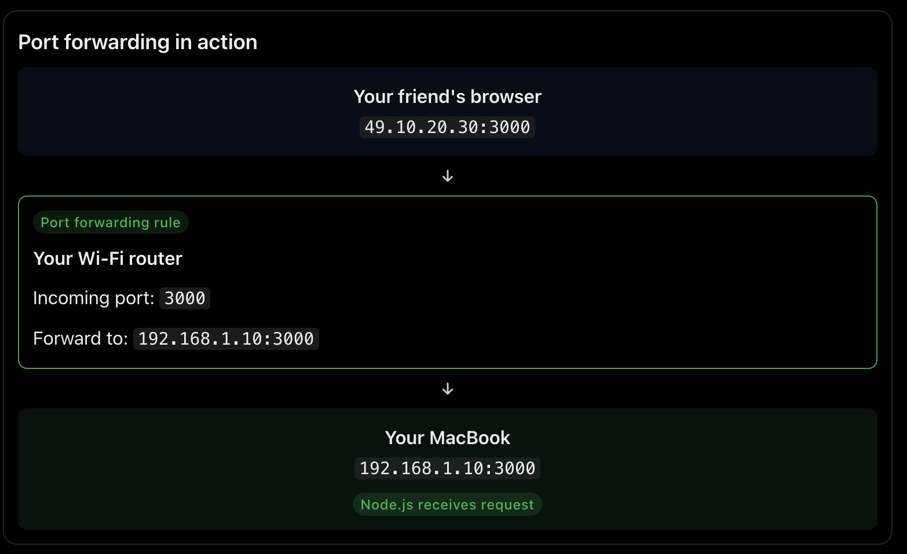

# Intro to DevOps

curl https://localhost:3000

127.0.0.1 is a ip address of my machine, but we don't write this while starting app using our ip address.

Our machine have there own DNS, here in above screenshot localhost is redirected to 127.0.0.1

Tried adding my own local dns route: yashika.local

Confirming if pinging to yashika.local will route to our local:

- ping : checks whether a machine is reachable over a network
- -c 4: sends 4 packets

In response mac resolved yashika.local to 127.0.0.1 using my hosts file entry, 4 packets transmitted and 4 packets received.

Loopback networking: 127.0.0.1 points back to my own machine.

`/etc/hosts` lets you manually map hostnames without configuring a DNS server.

Now our application is running on let's say port : 3000 which is connected to internet, we can have a public ip address , map it to yashika.local and others can use it if we keep our laptop 24/7 open.

Problems with this:

- You can't keep your laptops on 24/7
- The hardware of our laptop is not optimzied to be a server to handle traffic.
- Public ip's are limited, ipv4 have already been exhausted.

So our Internet Service provider keep us behind nat( network address translation), they route our request to let's suppose youtube.com and can provide us with public IP. Jio keeps us behind cgnat 9 carrier grade network address translation) which has one public IP for a particular area, so they can't provide public IP, other local service providers which are not behind cgnat can provide us with public IP.

- Here our wifi router is performing NAT, each device has its own private IP but it is sharing one public IP address accessing the internet.

Now, IP address helps to identify a machine in the network but what if i have 3 applications running, frontend, backend etc, and my mac has one IP address, but how does incoming network traffic know which application should receive it?

That's what ports help with!, which application on a machine. Now your friend wants to access your application on "http://49.10.20.30:3000" and your router has a public IP, where it can send and recieve packets over the internet. But how does my router will know which device should it forward to? also which application on a device? This is where port forwarding comes in.

**Port Forwarding**

Port forwarding is a rule that you configure on your router.

You're basically telling your router:

"When someone sends a request to my public IP on port 3000, forward that request to my Mac's private IP on port 3000."

The router forwards incoming traffic on a particular port to a particular device and port inside your network.

### **But wait, why do we need port forwarding if we already have a public IP?**

Having a public IP and having port forwarding are two different things.

A public IP makes your router reachable from the internet.

Port forwarding tells the router where to send particular incoming traffic.

**Now where does CGNAT break this process?**

Your router has an address in the CGNAT shared address range.

The public IP belongs to the ISP's CGNAT infrastructure, not your router.

Even if you configure port forwarding on your own router, the request first has to pass through the ISP's CGNAT device. Your router cannot configure the ISP's port forwarding rules. That's why your port forwarding configuration alone isn't sufficient.

Better idea is to have a server where we can deploy our application like AWS. Now instead of we manually taking our data in hardisk and deploying to aws server. I can deploy it virtually in cloud. Here comes the term DevOps ( Developer Operations).
