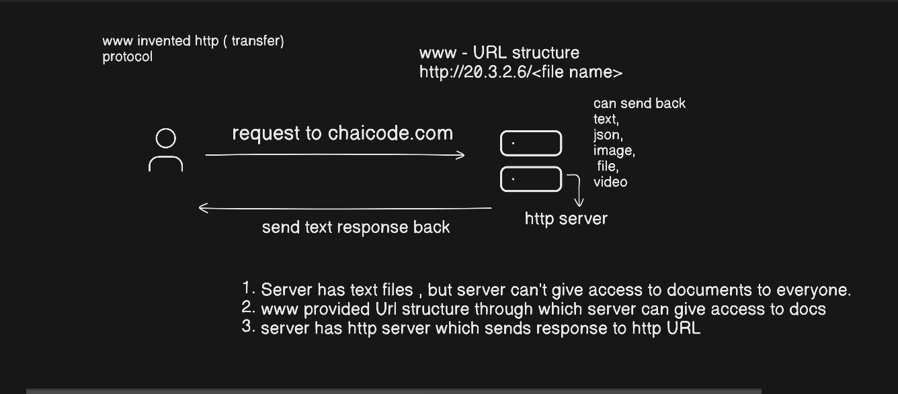

# Engineering Playground

I'm learning backend engineering by following one request from the browser
to the database and back. Each note is short and diagram-first, so I can use
it for quick revision.

## Request journey → notes

| Stage | Note |
|---|---|
| Response and Content-Type | [Content-Type and www](networking/content-type-and-www.md) |
| Browser page load | [Browser page load](networking/browser-page-load.md) |
| Web server | (coming) |
| Middleware, routing | (coming) backend/ |
| Query, indexes | (coming) database/ |

## Domains

| Domain | What it covers | Status |
|---|---|---|
| [networking](networking/README.md) | HTTP, browser, DNS, TCP/TLS | in progress |
| backend | servers, middleware, auth, caching, jobs | planned |
| database | SQL, indexes, query plans, transactions | planned |
| lld | OOP, SOLID, design patterns | planned |
| hld | system design | planned |
| distributed-systems | queues, Kafka, idempotency | planned |
| ai | embeddings, RAG, agents | planned |

Questions waiting to become notes live in [BACKLOG.md](BACKLOG.md).
New notes start from [_template.md](_template.md).
