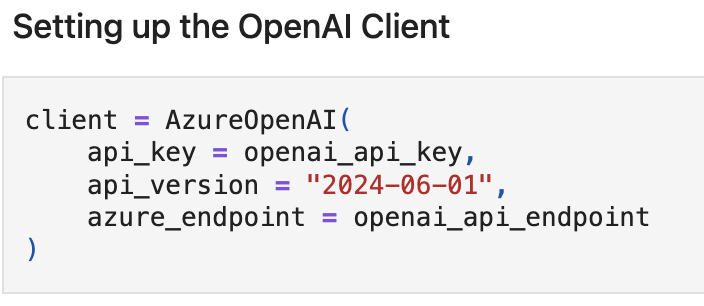
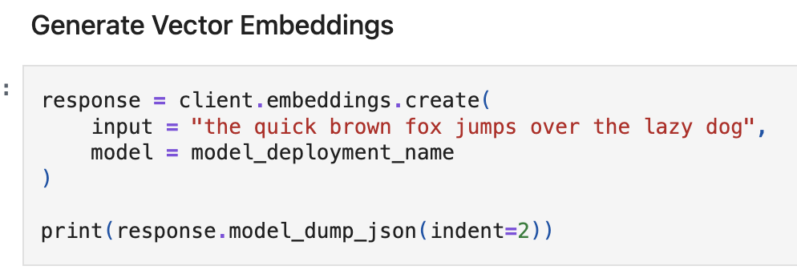

# Intro to Ai Agents and Compound AI Systems

Compound AI systems combines multiple interactive components to perform tasks.

AI Agent= LLM + Tools + Instructions

Agent will take decisions dynamically in contrast to hardcode logic

**Creating Foundry Agent in Portal**

Go to Agents -> Create Agent -> Select tools ( file searching, code interpreter to write python code ) -> Foundry IQ ( give knowledge base to agent)

Internal orchestration engine of Agent is the coordinator which manages what tasks should agent do like which tool should it call? does it need to search knowledge base etc etc based on user search query.

After recieving the response from agent we can check ai quality which will evaluate the intent of response, and give rating to it.

In traces tab you can check what tools it called, with conversation id of each chat done with agent, the sequence of how agent worked and all.

**RAG (Retrieval Augmented Generation)**

LLMs are trained on static data, to give info about our enterprise or to search for latest news from internet we need to give them tools or out of box access to get this data. Fine tuning falls short since we have to keep the models up to date which is hard for frequently changing data. RAG is faster and cheaper than fine tuning.

R: Search for relevant info

A: Feed retrieved content to model

G: Produce natural language response

**Vector Embeddings**

Way of representing data like text, image etc into numerical vector in high dimensional space. These vector embeddings are geenrated by text embedding models provided by AZure AI. For ex: if a word has diff meaning base don context they have diff vector embeddings.

Based on generated vector embeddings there is a similarity function which checks for top k vector embeddings, k can be anything depending on the output you want. In augementation step it takes user query + what rag give info combined info to generated answer ( augemented prompt) from LLM model. This is retrieval augmented generative architecture.

**Implementation of using vector embedding engine**

Select text embedding model from "Models" provided by open ai which is "text-embedding-ada-002" which return vectors of length 1536. Array of vector of length 1536. Vectors will be having numbers like 0.5, 03 etc, deploy this model.

We need open api endpoint, open api key and embedding model deployment name ( ext-embedding-ada-002) env file. Keys and endpoint we get from resource management for api endpoint and key.

We get vector embeddings between -1 to 1, embeddings: [1,2, 6.5, -1, ...]
