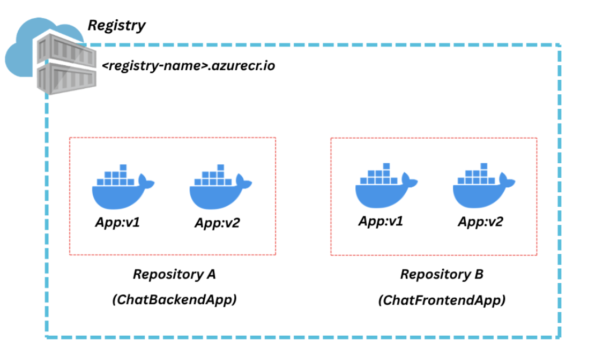

# Azure container Registry

Where to store our docker images?

- ACR helps to organize these docker images in a secure manner which can be shared with other individuals. We can restrict the ACR by roles access or allow only within virtual network to make it more secure.
- At top level we have Registry, ACR endpoint within this we have repositories which have different versions of images.

* ACR integrates directly with Azure services such as Azure Kubernetes Service (AKS), Azure Container Apps, Azure App Service, and Azure Machine Learning.
