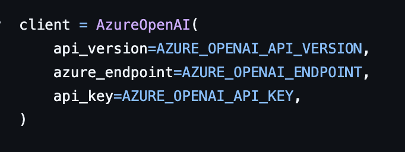
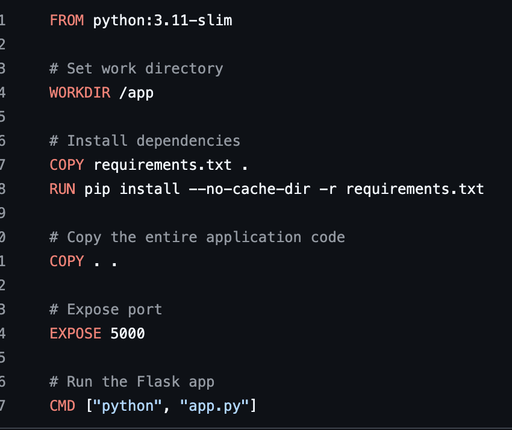

**Building and running AI app locally with Docker**

Create an AI app:

- Add openai endpoint, api key and azure model name from Micrososft Foundry ( model deployed to azure ) to .env file
- Load env variables from env file, make a call to azure open ai client
- 
- Add endpoints for the application, health route, port number etc.

Create a docker image for this application, for a python app like below. /app working directory should have .env, requirements.txt , app.py file etc to run our application.

- 

We will be running and building this above application in docker desktop. Steps are as follows:

- Run docker build command to build image inside root directory where app is situated. Ex: "docker build . -t myapp-latest", here '.' represent current directory is root directory, **`-t` or `--tag`.** Assigns a readable name and optional tag to the resulting image-t is to give readable tag to the image.
- Running it using "docker run -p 5000:5000 myapp-latest", here -p stands for mapping port number of host to port number of container. ( host:container)
- Make a request to your application using curl command in another terminal ( not the terminal where docker is running) to check if the request is successfull.

**To Push image to ACR**

- Open container registry in azure portal, create container registry with resource group.
- Open terminal, set the name of ACR registry as a env variable in terminal so that we don't have to type that again and again. Using command "export ACR_NAME= < your acr name >"<your-acr-name><your-acr-name>
- az acr login --name $ACR_NAME is used to authenticate from local to pull/push images to ACR without manually typing username and password, it will used existing active token from az login.
- docker tag SOURCE_IMAGE TARGET_IMAGE, this is the command to give our locally built image to be pushed with a target name to ACR. For ex: docker tag myapp-latest $ACR_NAME.azurecr.io/myapp-latest:v1.

* `SOURCE_IMAGE`: The image you already have locally.`TARGET_IMAGE`: The new name (including registry address) you want to assign to that image.

- Pushing image to ACR: docker push $ACR_NAME.azurecr.io/aoaipythonapp:v1

You will find your image ACR -> Services -> Repositories -> image with tag v1
