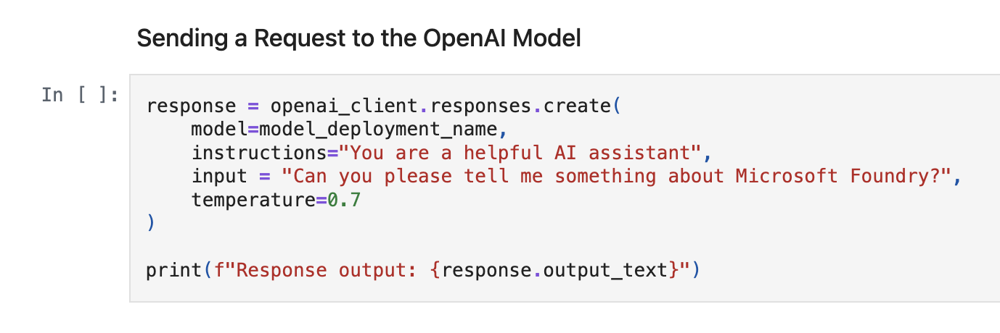

You can Deploy microsoft foundry as resource ( organization level) -> set up project ( team level) -> workspace

Steps:

create micrososft foundry resource ( resource group name, region, etc ) -> create project (name, region, ) -> deploy the resource

**Deploying with microsoft foundry resource and open ai model**

after the resource and project is deployed go to foundry portal (ai.azure.com) -> models -> select a model ( gpt-4.1) -> deploy -> custom settings ( guardrails) -> playground ( give instructions)

In playground settings, lower the temperature more accurate and formal the response, more the temperature more random and creative response will be.

**Micrososft Foundry SDK**

project\_client = AIProjectClient( endpoint=foundary_project_endpoint, credential=DefaultAzureCredential() ), this endpoint client has some sub clients like openAI client, anthropic client , agent service etc use acc to use case. This api client is used to connect with our foundry resource.

put foundry project endpoint and name of model from foundry portal and keep in .env file. login in to azure using azure cli from terminal using command "az login" . Use "az account show" to check which account you are currently logged into. Set up openai client: by calling sub client get_openai_client()

send req to open ai model:

On running this, we get response from open ai model.

Learn more from this repo's file: https://github.com/kuljotSB/Azure-AI-Cloud-Developer/blob/main/AI-Foundations/ChatCompletions.ipynb
