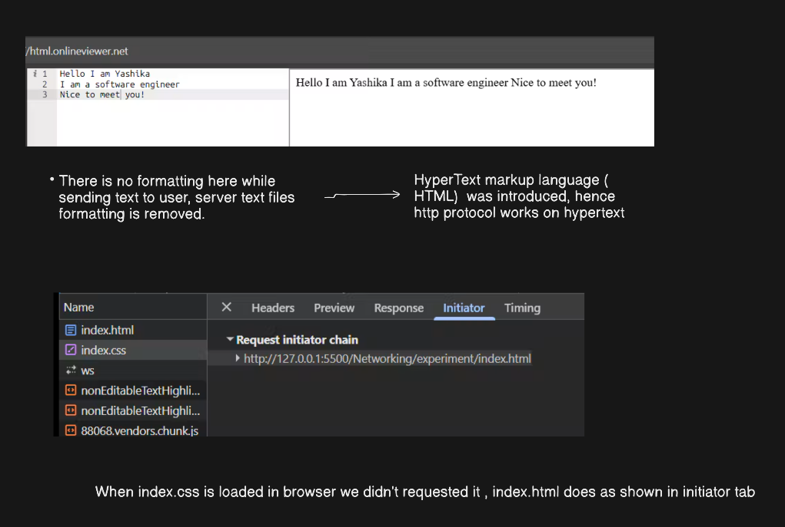

# Browser page load: one request leads to many

Stage: browser, after the first response

- I only requested `index.html`, but `index.css` also appeared in the Network tab. The Initiator tab showed `index.html` as the reason: the browser parsed the HTML, found the `<link>` and requested the CSS itself.
- So one page load is a chain of requests, each discovered while parsing the previous response.
- The browser knows `index.css` is CSS because its response has `Content-Type: text/css`.
- CSS is render-blocking: the browser keeps parsing the HTML but will not paint until the CSS is ready. A plain `<script>` is different, since it pauses HTML parsing itself unless it uses `defer` or `async`.
- A CDN keeps copies of static files (images, CSS, JS) on servers close to the user. The first request is slow, repeat requests come from the nearby cache.

**Interview line:** A page load is a tree of requests, and the HTML response is what triggers the rest.

Back to: [Content-Type and www](content-type-and-www.md)
