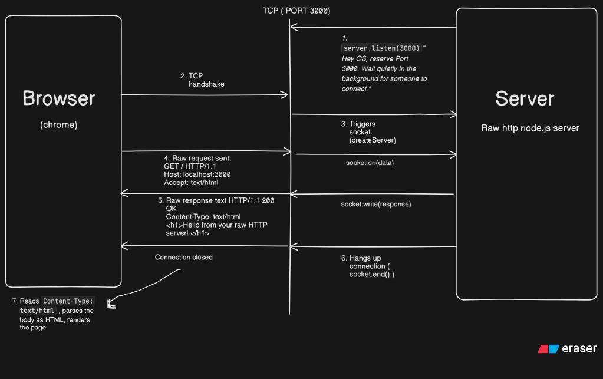

# Raw HTTP Server: The Request-Response Cycle from Scratch

Stage: Web server (the receiving end of a request)



## What was I trying to understand?

Before diving into backend frameworks (like Express or Fastify) or even Node's built-in `http` module, I wanted to see what HTTP is actually made of at the lowest level. 

- When Chrome sends a request, what does that look like on the wire?
- When a server replies, how does the browser know where headers end and the webpage begins?
- Is HTTP a complex binary protocol, or is it just text?

---

## The Mental Model (The 3 Actors)

1. **Browser (Chrome):** The client. It initiates connections, formats requests, reads response headers, and paints pixels.
2. **TCP Socket (Port 3000):** The bidirectional pipe provided by the Operating System. HTTP does not run on thin air—it runs as text streams over a persistent TCP connection.
3. **Server (`raw-http-server.js` via Node's `net` module):** A program that opens a port, receives raw byte chunks from the socket, and writes raw byte chunks back. Node's `net` module knows **nothing** about HTTP—it only knows TCP. Everything HTTP-related was written manually.

---

## The 7-Step Flow (Step-by-Step Breakdown)

### 1. `server.listen(3000)` (Setup)
Before any client connects, the server asks the Operating System to reserve **Port 3000**. The server enters the Node.js event loop and waits quietly for incoming network traffic.

### 2. TCP Handshake
When you type `http://localhost:3000` into Chrome and hit Enter, Chrome reaches out to port 3000 and performs a TCP 3-way handshake (SYN, SYN-ACK, ACK) to establish a reliable pipe.

### 3. Socket Allocation (`net.createServer`)
Once the handshake completes, the OS passes the active connection to Node.js. Node fires the `createServer` callback and hands us a dedicated **`socket`** object. This socket represents a two-way private phone line between the server and that specific browser tab.

### 4. The Raw Request (`socket.on('data')`)
Chrome pushes raw bytes down the TCP pipe. The server catches them with `socket.on('data', chunk => ...)` and converts them to text via `chunk.toString()`.

The text sent by Chrome has a strict 3-part format:
```http
GET / HTTP/1.1
Host: localhost:3000
Connection: keep-alive
User-Agent: Mozilla/5.0 (Windows NT 10.0; Win64; x64) Chrome/155.0...
Accept: text/html,application/xhtml+xml...
[EMPTY LINE \r\n]
```
- **Request line:** `GET` (Method) + `/` (Path) + `HTTP/1.1` (Protocol version).
- **Headers:** Key-value pairs describing client capabilities and cookies.
- **The Empty Line (`\r\n`):** Signals that the client has finished sending headers.

### 5. Crafting the Raw Response (`socket.write`)
Because we are using `net` instead of `http`, we have to build the response string by hand:
```http
HTTP/1.1 200 OK\r\n
Content-Type: text/html\r\n
\r\n
<h1>Hello from your raw HTTP server!</h1>
<p>You are seeing an HTTP response built manually string-by-string.</p>
```
- **Status line (`HTTP/1.1 200 OK`):** Tells the browser the request succeeded.
- **Headers (`Content-Type: text/html`):** Tells the browser how to interpret the upcoming bytes.
- **The Empty Line (`\r\n\r\n`):** The boundary wall. Without this blank line, the browser cannot distinguish headers from the body.
- **Body:** The raw HTML content.

### 6. Closing the Connection (`socket.end()`)
The server calls `socket.end()`. This flushes any remaining bytes and closes the TCP connection. In basic HTTP/1.1, hanging up signals to the browser: *"That is all the data for this response."*

### 7. Browser Rendering
Chrome reads `Content-Type: text/html`, recognizes that the connection has completed, parses the HTML markup into the DOM tree, and paints the heading and paragraph on screen.

---

## What I Saw (The Surprise in the Terminal)

I only typed `http://localhost:3000` once in the browser, but the terminal logged **three separate connections**:

1. `GET / HTTP/1.1` — The initial request for the page.
2. `GET /.well-known/appspecific/com.chrome.devtools.json HTTP/1.1` — Chrome DevTools looking for inspection configurations.
3. `GET /favicon.ico HTTP/1.1` — Chrome automatically requesting the tab icon.

This directly confirms the principle from [browser-page-load.md](../../browser-page-load.md): **a page load is not a single request, but a cascade of independent requests initiated automatically by the browser.**

---

## What I Got Wrong at First

- **I assumed HTTP was a complex binary protocol:** It is literally human-readable text sent over a TCP socket.
- **I thought servers magically send "webpages":** A server just sends text characters. The browser turns those characters into a webpage only because of `Content-Type: text/html`.
- **I didn't realize the empty line mattered:** The double CRLF (`\r\n\r\n`) is the actual delimiter defined in the HTTP specification that separates headers from payload data.

---

## Key Terms to Remember

| Term | What it actually is |
|---|---|
| **Port** | An addressable slot (like an apartment number) on an OS that an application listens to. |
| **TCP Socket** | An active, bidirectional communication channel between two IP endpoints. |
| **CRLF (`\r\n`)** | Carriage Return (`\r`) + Line Feed (`\n`), the required newline standard in HTTP headers. |
| **MIME Type** | A string like `text/html` or `application/json` that instructs the browser on how to parse the payload. |

---

**Key takeaway:** HTTP is plain text transmitted over a TCP socket, where headers and body are delimited by a double CRLF (`\r\n\r\n`), and the server explicitly terminates the stream to signal response completion.

Next: [node-http-server](../../README.md) (Using Node's built-in `http` module to abstract socket parsing).
